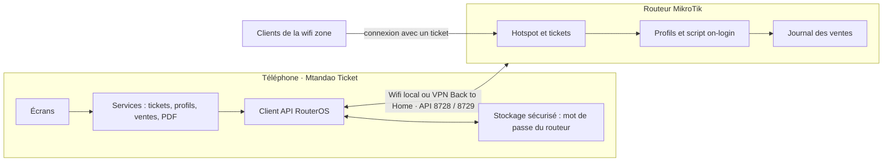
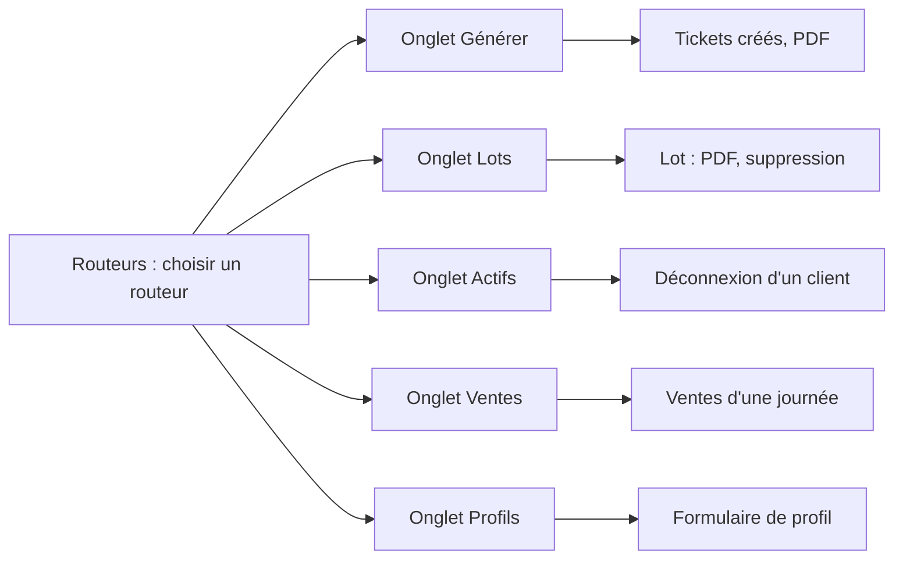

# Mtandao Ticket — Cahier des charges

Version du 2 novembre 2026 (brouillon à valider).

## 1. Contexte et objectifs

Mtandao Ticket est une application Android qui pilote le hotspot MikroTik d'une wifi zone depuis un téléphone : créer et imprimer des tickets, voir les connectés, suivre les ventes. Elle reprend l'esprit de Mikhmon, sans serveur PHP ni WinBox.

Objectifs :

- Gérer le hotspot entièrement depuis le téléphone.
- Fonctionner dans le wifi local et à distance, via le VPN « Back to Home » de MikroTik.
- Compter les ventes de façon fiable, sans saisie manuelle.
- Produire des tickets imprimables avec QR code.
- Rester simple : un gérant de wifi zone doit s'en servir sans formation longue.

État actuel : un prototype Flutter a été écrit (génération, PDF, actifs, ventes). Il sert de base d'étude ; il sera repris ou réécrit une fois ce cahier validé.

## 2. Périmètre

Proposition à valider : la V1 couvre les quatre fonctions demandées, plus ce qui les rend utilisables (routeurs et profils).

| Phase | Contenu |
| --- | --- |
| V1 | Routeurs enregistrés · profils · génération de tickets · PDF avec QR · lots · utilisateurs actifs · rapport de ventes · expiration en jours calendaires |
| V2 (candidats) | Export des ventes · sauvegarde des réglages |
| Hors périmètre | Serveur central ou cloud · paiement en ligne · iOS · gestion du routeur au-delà du hotspot (pare-feu, DHCP, etc.) |

Mise à jour prévue (V3) : un VPN intégré à l'application, du type « Back to Home » de MikroTik. Ce qui est possible et ce qui ne l'est pas est détaillé en section 12.

## 3. Utilisateurs et rôles

La V1 a un seul rôle d'utilisation : le gérant, qui détient le mot de passe du routeur.

| Rôle | Ce qu'il fait | Phase |
| --- | --- | --- |
| Gérant | Tout : routeurs, profils, génération, impression, suivi, ventes | V1 |
| Vendeur (à confirmer) | Distribue les tickets déjà générés, sans accès aux profils ni au rapport | V2 |
| Client de la wifi zone | Se connecte avec un ticket ; n'utilise pas l'application | — |

## 4. Besoins fonctionnels

Huit modules, 21 exigences. « Indispensable » = nécessaire pour la V1 ; « Souhaité » = utile, peut glisser en V2.

| Réf. | Module | Exigence | Priorité |
| --- | --- | --- | --- |
| F1 | Routeurs | Enregistrer plusieurs routeurs : nom, adresse, port, SSL, identifiants, devise, adresse de la page de connexion | Indispensable |
| F2 | Routeurs | Stocker le mot de passe du routeur dans le stockage sécurisé du téléphone | Indispensable |
| F3 | Routeurs | Afficher une erreur claire si le routeur est injoignable ou si l'identifiant est faux | Indispensable |
| F4 | Profils | Lister, créer, modifier, supprimer un profil : nom, durée, prix, débit, appareils simultanés | Indispensable |
| F5 | Profils | Installer sur le routeur le script qui enregistre chaque vente à la première connexion | Indispensable |
| F6 | Génération | Créer de 1 à 500 tickets en un lot, avec une barre de progression | Indispensable |
| F7 | Génération | Choisir préfixe, longueur du code (4 à 10) et type de caractères | Indispensable |
| F8 | Génération | Code unique, ou utilisateur et mot de passe distincts | Indispensable |
| F9 | Génération | Éviter les doublons de codes, y compris avec les tickets déjà sur le routeur | Indispensable |
| F10 | PDF | Produire un PDF A4 de tickets avec QR code de connexion | Indispensable |
| F11 | PDF | Partager le PDF (WhatsApp, e-mail…) et l'imprimer | Indispensable |
| F12 | PDF | Modèle de ticket personnalisable (logo, couleurs, taille) | Souhaité |
| F13 | Lots | Retrouver les lots de tickets non utilisés, les réimprimer, les supprimer | Indispensable |
| F14 | Actifs | Lister les connectés : utilisateur, adresse IP, MAC, durée, données échangées | Indispensable |
| F15 | Actifs | Déconnecter un client | Indispensable |
| F16 | Ventes | Rapport par mois, avec total encaissé et nombre de tickets | Indispensable |
| F17 | Ventes | Détail d'une journée : heure, ticket, profil, prix | Indispensable |
| F18 | Ventes | Exporter les ventes (CSV ou PDF) | Souhaité |
| F19 | Profils | Expiration en jours calendaires depuis la première connexion | Indispensable |
| F20 | Mode vente | Importer un PDF de tickets, afficher un ticket à la fois, marquer vendu, compteur | Abandonné (pas de fusion) |
| F21 | Routeurs | Sauvegarder et restaurer les réglages de l'application | Souhaité |

## 5. Besoins non fonctionnels

Les cibles chiffrées sont des propositions à valider.

| Domaine | Exigence |
| --- | --- |
| Sécurité | Mot de passe du routeur dans le stockage sécurisé Android, jamais en clair dans les préférences ni dans les journaux |
| Sécurité | Noms de profils, durées et débits validés avant d'être insérés dans un script RouterOS (aucune injection possible) |
| Sécurité | API jamais ouverte côté WAN ; utilisateur dédié sur le routeur recommandé plutôt que « admin » |
| Confidentialité | Aucune donnée de client ni de vente envoyée à un serveur tiers : tout reste entre le téléphone et le routeur |
| Réseau | Fonctionne en wifi local et via le VPN Back to Home ; reconnexion automatique après une coupure ou une veille |
| Hors connexion | Les routeurs enregistrés restent consultables sans réseau ; toute action sur le hotspot exige que le routeur soit joignable |
| Performance | Cible : lot de 100 tickets créé en moins de 60 secondes en wifi local ; rapport de ventes affiché en moins de 5 secondes |
| Compatibilité | Android 6.0 (API 23) ou plus ; RouterOS 6 (y compris avant 6.43) et RouterOS 7 |
| Ergonomie | Interface en français, utilisable d'une main sur téléphone, thème clair et sombre |
| Fiabilité | Une erreur au milieu d'un lot ne perd aucun ticket déjà créé : il reste visible dans « Lots » |

## 6. Architecture technique

Le téléphone parle directement à l'API RouterOS du MikroTik : pas de serveur intermédiaire, pas de base de données distante. Les ventes sont écrites par le routeur lui-même, puis lues par l'application.

Le téléphone ne parle qu'au routeur ; c'est le routeur qui note chaque vente quand un client utilise un ticket pour la première fois.

Choix techniques du prototype, à confirmer :

- Flutter (Dart), Android seulement en V1.
- Protocole API RouterOS sur TCP : port 8728, ou 8729 avec SSL ; client écrit dans l'application.
- `flutter_secure_storage` pour le mot de passe du routeur, `shared_preferences` pour les autres réglages.
- Paquets `pdf` et `printing` pour les tickets ; `crypto` pour l'authentification des anciens RouterOS.
- Accès à distance : l'application utilise l'adresse locale du routeur ; le VPN « Back to Home » fait le pont. Le service `api` du routeur doit accepter les connexions venant du réseau du VPN.

## 7. Conventions sur le routeur

L'application ne garde aucune base de données : l'état vit dans le routeur, grâce à cinq conventions. Elles doivent être testées sur le vrai routeur avant la V1 (voir section 11).

| Élément | Convention | Rôle |
| --- | --- | --- |
| Profil hotspot | Première ligne du script on-login : `#mkm:price=<prix>;uptime=<durée>` | L'application relit le prix et la durée du profil |
| Ticket non utilisé | Commentaire `vc-<jjmmaa>-<hhmm>` (code unique) ou `up-…` (utilisateur et mot de passe) | Regroupe les tickets en lots ; distingue les tickets neufs |
| Durée | Champ `limit-uptime` posé sur chaque utilisateur à la création | Le routeur coupe le ticket quand la durée est consommée |
| Vente | À la 1re connexion, le script ajoute un `/system script` avec le commentaire `mikhmon` et le nom `date-\|-heure-\|-ticket-\|-prix-\|-ip-\|-mac-\|-durée-\|-profil-\|-lot` | Source du rapport de ventes |
| Ticket utilisé | Le même script renomme le commentaire en `used-…` | Empêche de compter deux fois la même vente |

## 8. Écrans et navigation

Deux niveaux : la liste des routeurs, puis cinq onglets une fois connecté. Les maquettes détaillées restent à produire après validation de ce cahier.

La liste des routeurs est l'accueil ; chaque onglet ouvre au plus un écran de détail ou de formulaire.

## 9. Plan de réalisation

Cinq phases, avec trois points de contrôle. Aucune date n'est fixée : elles sont à décider après validation du cahier.

| Phase | Contenu | Point de contrôle à la fin |
| --- | --- | --- |
| Cadrage | Valider le plan, maquettes | Cahier validé : périmètre accepté |
| Socle | Client API, routeurs, profils | — |
| Tickets | Génération, PDF et lots | 1re vente comptée, sur le routeur réel |
| Suivi | Connectés, rapport de ventes | — |
| Essais | Routeur réel, APK de test | Mise en service : ventes exactes |

Les phases Socle et Suivi ne démarrent qu'une fois le point de contrôle précédent passé ; le prototype existant sert de point de départ pour le Socle.

## 10. Critères d'acceptation et tests

La V1 est acceptée quand ces huit tests passent sur le vrai routeur, avec un téléphone en wifi local puis via le VPN.

| Réf. | Test | Résultat attendu |
| --- | --- | --- |
| T1 | Connexion avec un mauvais mot de passe | Message clair, aucune action exécutée (F3) |
| T2 | Création d'un profil de 24 h à un prix donné | Profil visible dans WinBox avec son script on-login (F4, F5) |
| T3 | Génération de 100 tickets | Les 100 utilisateurs existent, codes tous différents, en moins de 60 s (F6 à F9) |
| T4 | Génération avec coupure du réseau au milieu | Les tickets déjà créés apparaissent dans « Lots » ; l'erreur est expliquée |
| T5 | PDF d'un lot imprimé et QR code scanné | Le QR ouvre la page de connexion avec le bon ticket (F10, F11) |
| T6 | Connexion d'un client avec un ticket | Il apparaît dans « Actifs » ; « Déconnecter » le coupe (F14, F15) |
| T7 | Même ticket utilisé deux fois | Une seule vente enregistrée (F16) |
| T8 | Rapport du mois comparé aux tickets vendus | Total et nombre de tickets identiques, sur RouterOS 6 et 7 si les deux sont disponibles (F16, F17) |

## 11. Risques et questions ouvertes

Le risque principal : le script de vente n'a jamais tourné sur le routeur réel, et le prototype n'a pas encore été compilé.

| Risque | Conséquence | Parade |
| --- | --- | --- |
| Script on-login non validé sur le vrai routeur | Ventes non comptées ou comptées deux fois | Test T7 et point de contrôle « 1re vente comptée » avant toute mise en service |
| Prototype jamais compilé | Erreurs de compilation, retards | Compiler et lancer l'analyse statique dès la phase Socle |
| Formats de date différents entre RouterOS 6 et 7 | Rapport faux ou vide | Lecture des deux formats ; test T8 sur la version réelle |
| Le VPN Back to Home n'autorise pas l'API | Accès à distance impossible | Vérifier la liste d'adresses autorisées du service `api` |
| Profils créés hors de l'application (WinBox, Mikhmon) | Leurs ventes ne sont pas comptées | Les ré-enregistrer depuis l'onglet Profils |
| Téléphone en veille ou réseau coupé pendant un lot | Lot incomplet | Reconnexion automatique ; tickets déjà créés visibles dans « Lots » |

Questions ouvertes — les réponses fixent la V1 :

- [ ] Un seul gérant sur un seul téléphone, ou plusieurs vendeurs avec des droits limités ?
- [ ] L'expiration en jours calendaires (depuis la première connexion) est-elle nécessaire dès la V1 ? Confirmé le 2 novembre 2026 : oui, retenue en V1 (F19).
- [ ] Faut-il fusionner avec l'application de vente de tickets (import de PDF, un ticket à la fois, compteur de vendus) ou garder deux applications ? Décidé le 2 novembre 2026 : pas de fusion, deux applications séparées.
- [ ] Format d'impression : feuille A4 en 3 colonnes, ou petits tickets pour une imprimante thermique ? Décidé le 2 novembre 2026 : feuille A4.
- [ ] Devise des prix : FC, USD, ou les deux ? Décidé le 2 novembre 2026 : FC uniquement.
- [ ] Modèle du routeur et version de RouterOS (6 ou 7) ?

## 12. Évolution prévue : VPN intégré (V3)

Décision du 2 novembre 2026 : cette évolution est reportée de plusieurs mois. Pour la V1, l'application s'appuie sur l'application « Back to Home » de MikroTik pour l'accès à distance.

Objectif : l'application ouvre elle-même le tunnel vers le routeur, sans passer par l'application « Back to Home » de MikroTik. Copier Back to Home à l'identique est impossible, car son relais appartient à MikroTik ; un VPN WireGuard intégré, configuré automatiquement par l'application, est possible.

Selon la [documentation de MikroTik](https://help.mikrotik.com/docs/x/BwAuD), Back to Home est basé sur WireGuard, demande RouterOS 7.11 ou plus et un routeur ARM, ARM64 ou TILE. Si le routeur n'a pas d'adresse IP publique, la connexion passe par un relais de MikroTik.

| Élément de Back to Home | Reproductible dans Mtandao Ticket ? |
| --- | --- |
| Tunnel WireGuard sur Android | Oui : tunnel WireGuard intégré à l'application, via le service VPN d'Android (licence de la bibliothèque et règles de Google Play à vérifier) |
| Configuration du routeur (interface WireGuard, pair, règles) | Oui : envoyée par l'application via l'API RouterOS, sans WinBox ; demande RouterOS 7 |
| Appairage d'un téléphone | Oui : l'application génère les clés et la configuration, avec un QR code pour un second appareil |
| Relais pour un routeur sans IP publique | Non : service de MikroTik. Il faut une IP publique sur le routeur, ou un relais à nous (petit serveur loué) |
| Routeurs compatibles | À vérifier pour ton modèle : les contraintes de Back to Home (ARM, ARM64, TILE) ne sont pas forcément celles de WireGuard seul |

Exigences provisoires :

- F22 : activer le VPN depuis l'écran d'un routeur, en un geste, avec configuration automatique du routeur.
- F23 : un téléphone = un pair WireGuard ; révoquer un téléphone perdu.
- F24 : afficher l'état du tunnel (connecté, injoignable) et le basculer en wifi local sans VPN.

Risque principal : si le routeur est derrière un CGNAT (fréquent avec Starlink et les opérateurs mobiles), un VPN sans relais ne peut pas le joindre.

Questions pour cette étape :

- [ ] Le routeur de la wifi zone a-t-il une adresse IP publique, ou est-il derrière un CGNAT ?
- [ ] Quel modèle de routeur (architecture), et quelle version de RouterOS ?
- [ ] Accepter de louer un petit serveur relais (coût mensuel) si le routeur n'a pas d'IP publique ?
